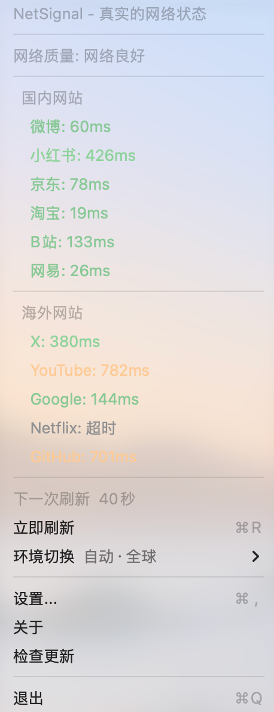

# NetSignal - macOS 网络状态监测工具

<p align="center">
  
</p>

NetSignal 是一款 macOS 菜单栏应用，通过监测国内外主要网站的访问速度，用直观的信号格图标反映当前网络状态。

<p align="center">
  
</p>

## 特性

- **信号格显示**：类似手机信号图标，1-4 格直观展示网络好坏
- **国内外区分**：同时监测国内网站（微博、小红书、京东、淘宝、B站、网易）和海外网站（X、YouTube、Google、Netflix、GitHub）
- **环境切换**：自动 / 全球 / 仅国内。自动模式会先探测海外可达性，可达按全球检测、不可达按仅国内检测
- **实时测速**：HEAD 请求测量网站响应时间（DNS + 连接 + 首字节）
- **自动刷新**：支持自定义刷新间隔（10-300 秒）
- **自定义网站**：可添加、删除、启用/禁用监测网站
- **开机启动**：支持设置开机自启
- **菜单倒计时**：菜单打开时显示"下一次刷新 X秒"倒计时
- **免费开源**：所有功能免费使用，无需付费

## 下载安装

- **GitHub Releases**：[v1.0.3 下载](https://github.com/jesse2023wang-collab/NetSignal/releases/tag/v1.0.3)（NetSignal-1.0.3.dmg）
- 下载后打开 `.dmg`，将 NetSignal 拖入 Applications 文件夹即可

## 版本日志

详见 [CHANGELOG.md](CHANGELOG.md)。

## ⚠️ 首次运行设置

macOS 默认只允许运行已签名的应用。NetSignal 作为开源软件，首次运行前需要开启「任何来源」：

### 1. 打开终端，执行以下命令

```bash
sudo spctl --master-disable
```

输入开机密码后生效。

### 2. 确认设置

打开 **系统设置 → 隐私与安全性**，在「安全性」区域应显示：

```
允许从以下位置下载的应用程序：
  ● App Store
  ○ App Store 和被认可的开发者
  ○ 任何来源  ← 已选中
```

### 3. 首次运行

- 打开 Applications 文件夹，**右键** NetSignal → **打开**
- 弹出确认框时点「打开」

> 如果仍然提示"无法打开"或"已损坏"，可以执行以下命令解除隔离属性：
> ```bash
> sudo xattr -rd com.apple.quarantine /Applications/NetSignal.app
> ```

### 关闭「任何来源」（可选）

安装完成后如需恢复 macOS 默认安全设置：

```bash
sudo spctl --master-enable
```

执行后「任何来源」选项将隐藏，但不影响已安装的 NetSignal 正常运行。

## 测速标准

| 响应时间 | 状态 | 颜色 |
|---------|------|------|
| < 200ms | 极快 | 🟢 绿色 |
| 200-500ms | 良好 | 🟢 绿色 |
| 500-1500ms | 一般 |  橙色 |
| > 1500ms | 较慢 | 🔴 红色 |
| 超时 | 超时 | ⚪ 灰色 |

## 信号格规则

| 平均响应时间 | 信号格 | 描述 |
|------------|-------|------|
| < 200ms | 4格 | 网络极佳 |
| 200-500ms | 3格 | 网络良好 |
| 500-1500ms | 2格 | 网络一般 |
| > 1500ms | 1格 | 网络较差 |
| 全部超时 | 0格 | 无网络 |

## 使用

- **左键点击菜单栏图标**：立即刷新网络检测
- **右键点击菜单栏图标**：打开功能菜单
- **菜单项**：
  - 立即刷新
  - 设置（自定义网站、自动刷新、开机启动）
  - 关于
  - 检查更新
  - 退出

## 构建

```bash
cd NetSignal
swift build
swift run
```

## 与竞品的区别

| 功能 | Ethernet Status | NetSignal |
|------|----------------|-----------|
| 菜单栏显示 | 支持 | 支持 |
| 信号格图标 | 不支持 | ✅ 支持 |
| 国内外网站测速 | 不支持 | ✅ 支持 |
| 自定义网站 | 不支持 | ✅ 支持 |
| 高级功能付费 | 是 | ✅ 否（全部免费） |
| 菜单倒计时 | 不支持 | ✅ 支持 |

## 系统要求

- macOS 13.0+
- Swift 5.9+

## 许可证

MIT License
